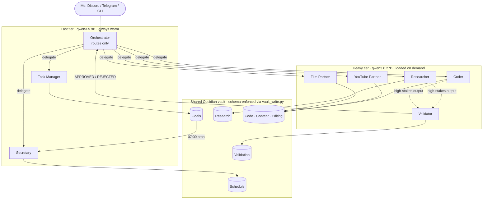

# Hermes local agents

A fully local multi-agent assistant built on [Hermes Agent](https://hermes-agent.nousresearch.com/) by Nous Research. One small orchestrator model takes every request and delegates it to seven specialists. A verification agent checks high-stakes work before it reaches me, and all agents share a structured Obsidian vault as long-term memory. Everything runs on a single consumer GPU: no cloud APIs and no data leaving the machine.

I talk to it through Discord and Telegram, or directly from the terminal.

## Architecture



| Agent | Model | Role |
|---|---|---|
| Orchestrator | qwen3.5 9B, 64k ctx | Single entry point. Classifies requests and delegates; has no web, code or media tools of its own |
| Researcher | qwen3.6 27B, 128k ctx | Multi-source research with citable handles (URLs, quotes, dates) |
| Coder | qwen3.6 27B, 128k ctx | Writes and runs code, reports real output instead of claims |
| Validator | qwen3.6 27B, 128k ctx | Re-checks evidence and returns APPROVED, APPROVED WITH NOTES or REJECTED |
| Task Manager | qwen3.5 9B, 64k ctx | Breaks long-term goals into small, dependency-ordered steps |
| Secretary | qwen3.5 9B, 64k ctx | Turns those steps into a realistic plan for today |
| YouTube Partner | qwen3.6 27B, 128k ctx | Collaborator through the video pipeline, from idea to publishing |
| Film Partner | qwen3.6 27B, 128k ctx | DaVinci Resolve editing and colour, down to the page, panel and node |

## Design decisions

**Model tiering to fit 24 GB of VRAM.** Two 27B models can't stay resident on an RX 7900 XTX, so agents are split by how much reasoning their job needs. Routing and planning run on a 9B model that stays warm; research, code, verification and creative work use a 27B model that Ollama loads on demand. The orchestrator runs at most two workers at once for the same reason. Each base model has a long-context variant, because tool schemas, skills and delegated results quickly overflow Ollama's default window.

**An orchestrator that can't do the work.** The orchestrator has web, browser, code execution and media tools disabled, and memory turned off. It can only classify and delegate, which keeps a small model reliable at the one thing it's for and stops it from answering questions it should hand off.

**Least-privilege toolsets.** Every agent gets only the tools its role needs. The Validator, for example, has terminal and web access to re-run tests and fetch sources, but no memory, so each verdict is judged on the evidence in front of it rather than on what earlier rounds concluded.

**MAVF, a verification layer that doesn't slow everything down.** Verification is triggered only by explicit importance flags, deep research, irreversible or public actions, and code that hasn't been run. Scheduling and creative brainstorming skip it. A rejection goes back to the original specialist for one revision, and after two failed rounds the disagreement is shown to me instead of looping. The rules live in one shared skill ([`skills/mavf`](skills/mavf/SKILL.md)) read by both the orchestrator and the Validator, so they can't drift apart.

**A shared vault instead of chat history.** Agents persist durable results to an Obsidian vault with one folder per agent. They never write markdown directly: every write goes through [`tools/vault_write.py`](tools/vault_write.py), which enforces a frontmatter schema per folder, fills ids and timestamps, and updates notes in place instead of duplicating them. Because notes link by id, a research finding links to the validation that approved it, and a daily plan links to the goal it advances. Obsidian Bases render each folder as a live table. Details in [`vault/README.md`](vault/README.md).

**Planning split in two.** Task Manager owns the long-term plan and Secretary owns the day. Every morning at 07:00 a cron job has the Secretary read the open goal steps, pick one small step per goal that fits the calendar, log it to `Schedule/` and send me a short brief. I can re-plan a goal without touching my day, or reshuffle a day without touching the plan.

## Repository layout

| Path | Contents |
|---|---|
| `profiles/<agent>/` | `config.yaml` (model, toolsets, delegation) and `SOUL.md` (role and rules) for each agent |
| `skills/` | Shared skills loaded by every profile: `mavf` and `obsidian-vault` |
| `tools/vault_write.py` | Schema-enforcing vault writer, no dependencies |
| `tests/` | Tests for the vault writer |
| `vault/` | Vault structure, frontmatter schema and the Obsidian Bases views |
| `setup/` | Install, model and configuration scripts, plus a health check |

## Setup

Tested on Kubuntu 24.04 with an AMD RX 7900 XTX (ROCm). Any GPU that Ollama supports with 24 GB of VRAM should work.

```bash
setup/01-install.sh        # ROCm, Ollama, Hermes Agent
setup/02-ollama-models.sh  # both tiers plus long-context variants
setup/03-configure.sh      # profiles, shared skills, vault, morning cron job
cp .env.example ~/.hermes/profiles/orchestrator/.env   # add bot tokens
orchestrator gateway install && orchestrator gateway start
setup/check.sh
```

Then talk to `orchestrator chat`, or message the bot. Every specialist is also reachable directly (`coder chat`) when routing isn't needed.

```bash
python -m pytest tests/    # vault writer tests
```

## Stack

Hermes Agent · Ollama · Qwen3.5 9B / Qwen3.6 27B · ROCm · SearXNG · Firecrawl · Obsidian Bases · Discord / Telegram gateway · systemd

Óscar Ferrer Domingo
